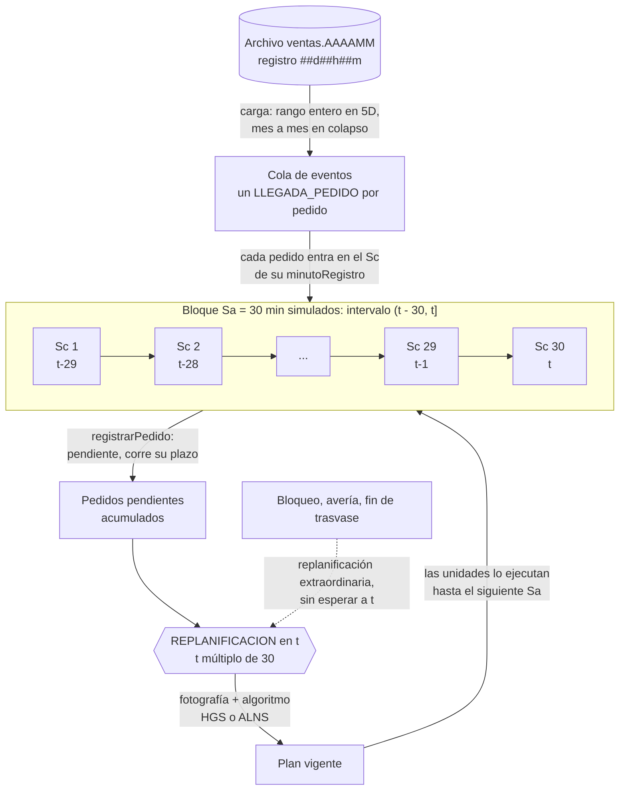
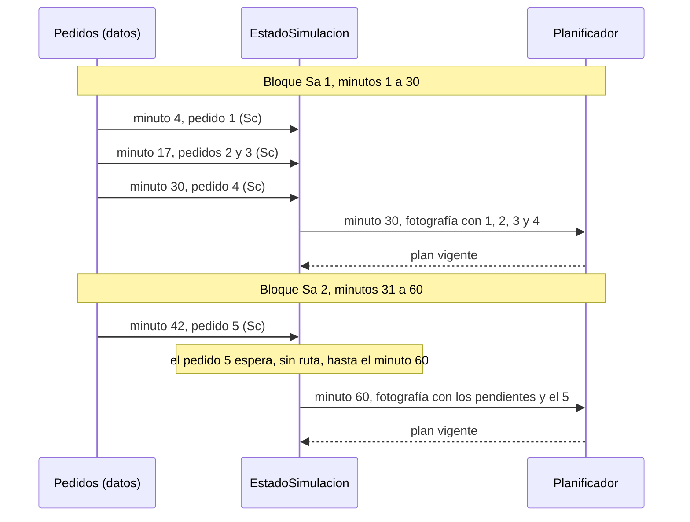

# Salto de consumo (Sc) y salto del algoritmo (Sa)

## Resumen

| Salto | Qué mide | Valor | Dónde se fija |
|---|---|---|---|
| **Sc**, salto de consumo | Cada cuánto entra un dato nuevo al estado de la simulación | **1 minuto simulado** (efectivo) | No es un parámetro: sale de la resolución de los datos |
| **Sa**, salto del algoritmo | Cada cuánto se ejecuta el planificador de forma periódica | **30 minutos simulados** | `kindbox.salto-minutos-por-defecto`, o `saltoMinutos` en `POST /api/simulaciones` |

Por lo tanto, **Sa / Sc = 30**: cada bloque Sa contiene 30 bloques Sc.

**El código no tiene una variable Sc.** El motor no lee los pedidos en lotes de tamaño fijo. Está dirigido por eventos (`TipoEvento`, `MotorEjecucion.bucle`): cada pedido es un evento `LLEGADA_PEDIDO` programado en su `minutoRegistro` exacto. Sc vale 1 minuto porque el reloj interno avanza en minutos enteros y los archivos de ventas registran el instante con formato `##d##h##m`, sin segundos. Nada más fino se puede representar, y el motor tampoco agrupa más grueso.

Un minuto sin pedidos no cuesta nada: el motor salta directo al siguiente evento. Hablar de "bloques Sc" describe la granularidad del consumo, no un ciclo que se ejecute 30 veces.

## Cómo se consumen los pedidos

1. **Carga.** Los pedidos se leen del archivo y quedan en memoria, pero todavía no existen para la simulación.
   - Simulación de 5 días: se carga el rango entero al arrancar.
   - Colapso: se carga mes a mes con el evento `CARGA_TRAMO`.
   - Con un inicio a media jornada, `sinPedidosAntesDe` descarta lo anterior al arranque.
2. **Siembra.** `sembrarVentana` programa un `LLEGADA_PEDIDO` por pedido, y los eventos `REPLANIFICACION` en los múltiplos de Sa.
3. **Consumo (Sc).** Al llegar a `minutoRegistro`, `EstadoSimulacion.registrarPedido` lo marca como registrado y pendiente, y empieza a contar su plazo. Desde ahí puede vencer.
4. **Planificación (Sa).** En cada múltiplo de Sa, `replanificar` toma una fotografía del estado y el algoritmo resuelve con **todos** los pedidos pendientes acumulados, no solo con los del último bloque.

### Orden dentro de un mismo minuto

El orden de declaración de `TipoEvento` resuelve los empates, y `LLEGADA_PEDIDO` va antes que `REPLANIFICACION`. Por eso un pedido registrado justo en el minuto 30 entra en la planificación de ese mismo minuto. Cada bloque Sa consume entonces el intervalo `(t − 30, t]`.

### Lo que implica para un pedido

Un pedido consumido en un Sc no recibe ruta hasta el siguiente Sa. En el peor caso espera 29 minutos simulados, si no ocurre antes una replanificación extraordinaria. Ese tiempo ya corre contra su plazo.

## Diagrama

Un bloque Sa de 30 minutos, con sus 30 bloques Sc de 1 minuto:

Línea de tiempo de dos bloques Sa:

## Datos reales

En `data_dp1/ventas/ventas.202609.txt`, un mes de 43 200 minutos:

| Medida | Valor |
|---|---|
| Pedidos | 5 000 |
| Minutos con al menos un pedido | 4 684 (10,8 %) |
| Minutos con dos o más pedidos | 304 |
| Máximo de pedidos en un minuto | 3 |
| Promedio por bloque Sa | 3,5 pedidos |

El 89 % de los bloques Sc no trae ningún pedido, lo que justifica un motor por eventos en lugar de uno que recorra cada minuto.

## Relación con el tiempo real

El factor de aceleración K convierte los saltos a tiempo real. En 5D, `K = 7 200 / minutos reales`, y por defecto la corrida dura 30 minutos reales, así que K = 240:

| Medida | Simulado | Real, con K = 240 |
|---|---|---|
| Sc | 1 min | 250 ms |
| Sa | 30 min | 7,5 s |
| Presupuesto del planificador por Sa | | 4,5 s (60 % de Sa / K) |

En la simulación, el planificador corre dentro del hilo del motor. El consumo de pedidos se detiene mientras busca y luego se pone al día con el reloj.

## Otros saltos que no son Sc

- **Fotografías del visualizador.** `minutosEntreFotografias` vale 5 min en 5D y 15 min en colapso. Solo define qué tan seguido se publica el estado; no consume datos.
- **Replanificación extraordinaria.** Bloqueos, averías y fin de trasvase piden una replanificación en el minuto en que ocurren, sin esperar al múltiplo de Sa. En operación diaria también lo hacen un pedido nuevo, un cambio de parámetros y la reposición de almacenes.
- **Arranque fuera de múltiplo.** Si la hora de inicio no cae en un múltiplo de Sa, por ejemplo 10:45, `programarPlanInicial` planifica en ese primer minuto y luego sigue en los múltiplos: 11:00, 11:30.

## Operación diaria

Aquí no hay archivo de ventas que consumir. El pedido entra por `POST /api/operaciones/{id}/pedidos` e `incorporarPedido` lo registra y pide una replanificación con motivo `PEDIDO_NUEVO`, sin esperar al Sa. K vale 1 y `MotorOperacion.actualizar` avanza el motor al minuto del reloj real. Sa se conserva como replanificación periódica, con `saltoMinutos` de 30 por defecto.
